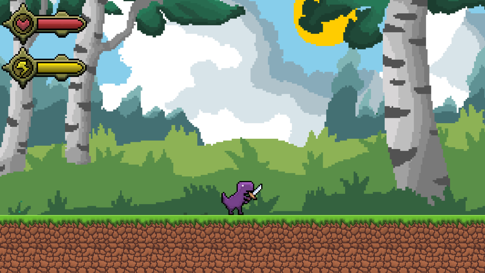

# Rex Valley 

## Introduction



**Rex Valley** is a Single-Player, small **action-adventure** game featuring the **Google Dino** as its lead protagonist! Explore this 2D world, featuring beautiful **pixel-art**, unique **bosses** and a simple yet effective, combat system. 

This **art** and the **game** itself have been made with passion by three amateur programmers for [ThirdSpace](https://thirdspace.hackclub.com/home) a [Hack Club](https://hackclub.com) YSWS.

## Running the project

### Pre-built executables

1. Download the latest build from the releases section of this repo.

### Build from Source

1. Install [Godot 4.7.2+](https://godotengine.org/) and clone the repo
```
	git clone https://github.com/LeeTuah/rexvalley.git
```

2. Inside Godot click **Import** and select the **project.godot** file inside the cloned folder.

3. Run the project and select game_manager.tscn as the main scene if asked.

## Description

This game has been inspired from the famous Chrome Dino Run. The player here is also a dino but with much superior movement.
He can do stuff like magic, slam attacks, sword attacks, combos, heal, etc.

The current state of the game features two levels where the first is a tutorial level and the second is a boss level.
The boss is humanoid and has a boss health bar and basic attacks for now. 

All the dino mechanics include:
	Sword Slashes (3 variants, hoever the second and third only plays during combo attacks)
	Thrust Attack (The player quickly thrusts forward piercing through the enemy)
	Plunge Attack (The player jumps very high and comes crashing down on the ground dealing consideral damage to nearby enemies)
	Magic Fireball (Launches a fireball at the direction the player is facing, deals considerable damage)
	Magic Shield (Summons a shield over the player which decreases damage taken, a perfect parry negates all damage)
	Magic Heal (The player heals by drinking from a magic bottle)
	
	
